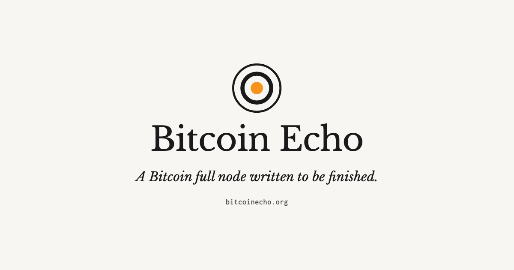

  <picture>
    <source media="(prefers-color-scheme: dark)" srcset="https://raw.githubusercontent.com/bitcoinecho/.github/main/profile/share-dark.png">
    
  </picture>

**Bitcoin Echo is a Bitcoin full node written to be finished.**

Echo is being rebuilt. The code and pages that were here described an earlier build and have been taken down. They return when there is something you can check for yourself.

[bitcoinecho.org](https://bitcoinecho.org) · [echo@bitcoinecho.org](mailto:echo@bitcoinecho.org) · [𝕏 @bitcoinechoorg](https://x.com/bitcoinechoorg)
